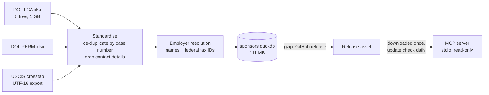

# h1b-sponsor-mcp

[](https://github.com/janishkumar/h1b-sponsor-mcp/actions/workflows/ci.yml)

**Ask Claude "is this company still sponsoring H-1Bs?" and get a straight answer in tables, built from 1.28 million public government filings plus USCIS approval records.**

An MCP server for job seekers who'll need visa sponsorship. It combines all three public sponsorship signals for each employer, shows how they've moved over the last six months against the same months a year earlier, and runs locally on a database that updates each quarter.

```
You:     Compare Microsoft, Amazon, Google, Meta, Apple and Nvidia for data scientist sponsorship.
Claude:  (calls compare_companies)
```

| Company | LCAs Jan–Jun 2026 | of which new employment | vs a year earlier | PERM certified, last 12 mo | USCIS new-employment approvals FY2025 | Still sponsoring? |
| --- | ---: | ---: | ---: | ---: | ---: | --- |
| Microsoft Corporation | 351 | 152 | -15% | 147 | 1,394 | Yes, active |
| Amazon.com Services LLC | 616 | 334 | +32% | 1 | 4,637 | Yes, active |
| Google LLC | 240 | 150 | +8% | 0 | 1,042 | Yes, active |
| Meta Platforms, Inc | 386 | 210 | +2% | 9 | 1,554 | Yes, active |
| Apple Inc. | 137 | 67 | +69% | 3 | 827 | Yes, active |
| NVIDIA Corporation | 7 | 0 | +75% | 8 | 560 | Yes, active |

<sub>Real output, data through Jun 30, 2026. LCA and PERM columns are filtered to data-scientist roles; the USCIS column is company-wide.</sub>

That one table answers two questions most sponsorship sites can't. Is the company still filing *this year*, and in which direction? And will it take you through to a green card? Amazon and Google are filing plenty of H-1Bs for data scientists, but certified almost no green-card (PERM) cases for them in the last 12 months.

## What it can answer

| Tool | Example question |
|---|---|
| `company_sponsorship` | "Is Stripe still sponsoring? Just data roles in New York." |
| `compare_companies` | "Compare Databricks, Snowflake and Stripe." |
| `top_sponsors` | "Who sponsors machine learning engineers in Georgia?" |
| `salary_range` | "What do H-1B data scientists get offered in Atlanta, by level?" |
| `find_employer` | "Which Deloitte entities file separately?" |
| `data_info` | "What data is this based on, and how current is it?" |

Every answer is a markdown table that names its date window ("Jan–Jun 2026", never just "last 6 months") and says what the numbers do and don't mean.

## Install

You need [uv](https://docs.astral.sh/uv/). The first run downloads the database (about 61 MB compressed) and caches it; after that everything is local and offline.

**Claude Desktop**: add to `claude_desktop_config.json`:

```json
{
  "mcpServers": {
    "h1b-sponsor": {
      "command": "uvx",
      "args": ["--from", "git+https://github.com/janishkumar/h1b-sponsor-mcp", "h1b-sponsor-mcp"]
    }
  }
}
```

**Claude Code**:

```bash
claude mcp add h1b-sponsor -- uvx --from git+https://github.com/janishkumar/h1b-sponsor-mcp h1b-sponsor-mcp
```

Any other MCP client works the same way: run `h1b-sponsor-mcp` over stdio.

## Where the numbers come from

| Signal | Source | What it tells you | Coverage |
|---|---|---|---|
| H-1B LCAs | DOL Labor Condition Application disclosures | The freshest signal: an employer is preparing H-1B petitions. Split into **new employment** (e.g. from F-1/OPT) and **transfers** from other employers. | Decisions Oct 2024 – Jun 2026 (1.02M filings) |
| Green cards | DOL PERM disclosures | Whether the company sponsors permanent residence | Decisions Oct 2024 – Jun 2026 (259K cases) |
| Confirmed petitions | USCIS H-1B Employer Data Hub | Approvals and denials by petition type, per fiscal year | FY2023 – FY2026 Q3 |

**How current is it?** DOL publishes each quarter about 5–6 weeks after it ends, so the data is between 1.5 and 5 months old at any time. Every H-1B site uses these same files, so none can be fresher. Windows are anchored on the newest decision in the data, not today, so "last 6 months" is always a fully covered window.

**What an LCA is not.** An LCA is a filing an employer makes *before* an H-1B petition. It covers new hires, renewals and transfers, and some never become petitions. Treat LCA counts as an upper bound on sponsorship activity. The USCIS columns are the confirmed side.

**"Still sponsoring?"** is a rule, not a model. It looks at certified LCAs in the last 6 months against the same months a year earlier:

| Verdict | Rule |
|---|---|
| Yes, active | 5+ filings, and not down by half or more |
| Slowing sharply (−x%) | at least 10 filings a year earlier, and down 50% or more |
| Occasional | 1–4 filings |
| No filings in last 6 months | none in 6 months, some in the last 12 |
| No recent sponsorship | none in 12 months |

## How it's built



- **Employer names are messy.** Names that file under a shared federal tax ID are merged: "Amazon.com Services LLC", "AMAZON.COM SERVICES LLC", "Amazon Web Services, Inc." and "Amazon Development Center U.S., Inc." count as one employer. Two guards stop bad merges. A tax ID shared by more than 12 names is almost always a payroll provider, so it's ignored. And a name only joins a tax ID's cluster if its first word matches the main filer's. 1.28M filings resolve to 156,896 employers.
- **Search matches whole leading words.** "Amazon" finds Amazon.com Services, Amazon Web Services and Amazon Data Services, and lists them, so you can see exactly what was counted. If a name catches something unrelated ("Apple" also matches Apple Tree Dental), `find_employer` gives you the exact name to pass instead.
- **No personal data ships.** The source files include employer contact names, emails and phone numbers, plus attorneys and preparers. The build drops all of it, and a test checks that the published database contains none of those columns.
- **Lean runtime.** The server installs only `mcp`, `duckdb` and `platformdirs`. Answers take under a second.

## What didn't work (and what replaced it)

- **Tax IDs alone over-merge.** The first build merged everything that ever shared a tax ID, and "Amazon" came back with TechCorp Solutions Inc. in it: a small firm whose 21 filings list one of Amazon's tax IDs, almost certainly a keying error. A name now joins a tax ID's cluster only if its first word matches the main filer's. A regression test covers it.
- **"Last 6 months" was off by a day.** Subtracting six months from June 30 lands on December 30, so the first window read "Dec 2025–Jun 2026". Windows are now whole calendar months (Jan–Jun 2026 vs Jan–Jun 2025), with tests for month-end and mid-month anchors.
- **Prefix search catches neighbours.** "Apple" also matches Apple Tree Dental. Fuzzy brand matching would hide that rather than fix it, so every answer lists the entities it counted, and `find_employer` gives you the exact name to narrow it.
- **The government sites block scripts.** The plan was a scheduled GitHub Action that refreshed the data every quarter. DOL and USCIS both return 403 to automated downloads, so the refresh is a short manual browser step and everything after it is one command.

## Compared with other H-1B MCP servers

I checked what already existed before building this. As of October 2026:

| | This server | [h1b-job-search-mcp](https://glama.ai/mcp/servers/x4599r3djj) | [h1b-mcp](https://pypi.org/project/h1b-mcp/) | Hosted connectors (Pipeworx, MCPBundles) |
|---|---|---|---|---|
| LCA filings | ✅ 21 months | ✅ one quarter at a time | via H1BGrader | ✅ |
| USCIS approvals and denials | ✅ by petition type | — | — | — |
| Green-card (PERM) filings | ✅ | — | — | — |
| Trend vs. a year earlier | ✅ | — | — | — |
| Employer names merged via tax ID | ✅ | — | — | — |
| Runs locally and offline | ✅ | downloads raw files on demand | scrapes a third-party site | hosted |

## Keeping the data fresh (maintainers)

DOL and USCIS block scripted downloads, so a refresh is a few minutes in a browser each quarter, usually mid-February, May, August and November:

1. From the [DOL performance data page](https://www.dol.gov/agencies/eta/foreign-labor/performance), download the newest `LCA_Disclosure_Data_FY…` and `PERM_Disclosure_Data_FY…` files into `data/raw/dol/`. Current-year files are cumulative, so replace the previous quarter's file.
2. From the [USCIS H-1B Employer Data Hub](https://www.uscis.gov/tools/reports-and-studies/h-1b-employer-data-hub), use Crosstab View → Download → CSV into `data/raw/uscis/`.
3. Then:

```bash
make setup
make data USCIS_THROUGH="FY2026 Q4"
make inspect
make release
```

`make release` publishes `sponsors.duckdb.gz` as a GitHub release, and every user's server picks it up within a day.

## Development

```bash
make setup && make test
```

36 tests run on a synthetic fixture with one planted example of each case: a company that's slowing, one that's steady, one that's stopped, a payroll-provider tax ID, a duplicate case number, a non-H-1B visa class, and a contact-email column that must not survive the build. They also start the real server over stdio and call it as an MCP client would. CI runs on Python 3.11–3.13, checks that the wheel installs without the build extras, and runs a dependency audit and secret scan.

## Not legal advice

This is public filing data. It can't tell you whether a particular team will sponsor a particular role, and policies change. Ask the employer.
